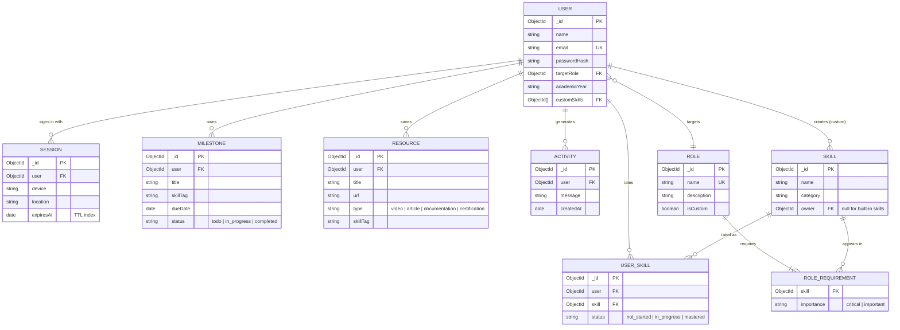

# CareerCompass – Entity Relationship Diagram

`ROLE_REQUIREMENT` is an embedded sub-document inside `ROLE` (an array of `{ skill, importance }`).

## Design notes
- **Unique indexes:** `User.email`, `Role.name`, `UserSkill(user, skill)`, `Skill(name, owner)`.
- **Ownership:** every Milestone, Resource, UserSkill, Session and Activity stores `user`, and every query filters by it, so students can only touch their own data.
- **TTL index:** `Session.expiresAt` lets MongoDB delete expired sessions automatically.